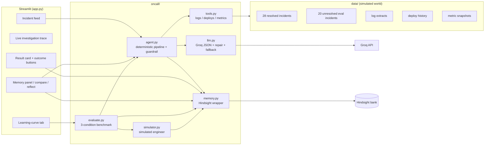

# Architecture

OnCall Memory is one persona, one workflow: an on-call engineer triaging a
production alert, with **Hindsight** as long-term memory. Everything it reads is
simulated; no real infrastructure is touched and no fix is executed.



## Investigation flow (v1, default)

1. **Alert** arrives from the feed (eval incident: id, service, alert, timestamp,
   symptoms). The hidden `true_fix` is never given to the agent.
2. **Evidence in fixed order**: `get_logs`, `get_recent_deploys` (own service +
   dependencies, 6h window), `get_metrics`. Each emits a step event, so the UI
   shows what is happening and how long it took.
3. **Pattern classification** (`tools.detect_pattern`): distinctive error strings
   from `data/families.json` identify the failure family (e.g. `x509` +
   "certificate has expired" → TLS). This is runbook logic over the visible
   logs, not a peek at the incident's stored family label.
4. **Recall (memory ON only)**: the query is built from the alert, symptoms, the
   service and the *actual log excerpt*, and asks for the matching past incident
   and its fix outcomes. Recalled facts are grouped back into incident-level
   memories by the metadata Hindsight returns with each fact. Results from a
   different detected pattern are dropped: a novel alert must be allowed to come
   back empty rather than cite a superficially similar incident.
5. **Reasoning**: Groq receives the incident, logs, deploys, metric summary,
   recalled memories and an explicit per-fix record derived from memory metadata
   (`worked 2/2 | failed 1`). It must return `AgentResult` JSON (validated by
   pydantic). On invalid JSON: one repair retry, then the fallback model, then a
   deterministic analyst answer.
6. **Memory guardrail**: fixes recorded as failing for this pattern are demoted
   below fixes with recorded successes; a known-good fix missing from the answer
   is surfaced. Conflicting outcomes (worked once, failed later) are called out
   and confidence is capped at medium.
7. **Result card**: cause, confidence, evidence, similar incidents, ranked fixes
   with "from memory" badges and outcome counts.
8. **Outcome feedback**: Worked / Failed / Partial retains a single
   `outcome-<incident>-<fix>` document. Stable document IDs make duplicate clicks
   idempotent.

## What memory stores

Each resolved incident is **one self-contained postmortem document**:

```
Incident INC-014 (checkout-service, 2026-06-02).
Alert: checkout-service p95 latency > 2000ms for 5m.
Symptom: p95 latency 4.1s (SLO 400ms); ConnectionPoolTimeoutError in logs.
Root cause: Redis connection pool exhausted after deploy v2.31.0 cut the pool from 50 to 20 ...
Fixes: restart_service ... -> FAILED (...); rollback_deploy_and_increase_pool ... -> WORKED (...).
Resolved in 25 min by priya.
```

- `document_id=incident-INC-014` → re-seeding replaces, never duplicates.
- `context="incident postmortem"`, `timestamp=incident.opened_at` (real event
  time, so temporal recall works).
- `metadata`: `record_type`, `incident_id`, `service`, `family`,
  `outcomes="restart_service:failed;rollback_deploy_and_increase_pool:worked"`.

Outcome memories are separate documents (`outcome-INC-101-<fix>`) with the alert
text, fix, outcome and service/family metadata, retained when the engineer clicks
a button (or when the simulated engineer resolves an incident in condition C).

Why metadata matters: Hindsight extracts and may rephrase facts, but metadata is
returned verbatim on every recalled fact. It is therefore the reliable channel
for (a) attributing a fact to an incident, (b) filtering by failure pattern, and
(c) computing exact worked/failed counts instead of parsing prose.

## Recall, reflect and why raw facts

`recall` uses semantic + keyword + graph + temporal retrieval inside Hindsight.
We request `types=["world","experience"]`, not consolidated observations:
observations come back with `metadata=None` and no `document_id`, so they cannot
be attributed to an incident or filtered by pattern. Provenance is worth more
than consolidation for triage. `reflect` is used separately for the "what do we
know about this service?" panel, where a synthesized answer is exactly what is
wanted.

## Reliability ladder

| Failure | Behaviour |
|---|---|
| Hindsight unreachable / no URL | Visible warning; local keyword fallback (clearly labelled, demo only) |
| Hindsight recall fails mid-run | Investigation continues with memory OFF behaviour + visible error |
| Groq invalid JSON / schema violation | Repair retry with the validation error and schema |
| Groq primary model keeps failing | Retry with `GROQ_FALLBACK_MODEL` |
| Groq 429 | Exponential backoff, then next attempt |
| No Groq key / all retries fail | Deterministic analyst; flagged in the UI and the CSV |
| Duplicate outcome click | Same `document_id` → upsert, not a second memory |
| Empty/garbled logs | Stated limitation in evidence, confidence forced low |
| Novel incident | `no_relevant_history=true`, no invented incident IDs, low confidence |

## Benchmark design

`python -m oncall.evaluate` runs the same 20 eval incidents in three conditions,
each on a **fresh bank** (`oncall-eval-<run>-<condition>`), never the demo bank:

- **A `A_off`** — memory disabled; recall is never called.
- **B `B_seeded`** — the 28 history incidents are seeded, outcomes are not written
  back.
- **C `C_learning`** — seeded, and after every incident the simulated engineer's
  attempted fixes (failed ones included) are retained as outcomes.

`simulator.SimulatedEngineer` walks the agent's ranked fixes until the hidden
`true_fix` is reached: wrong fixes fail, cost 8 simulated minutes, and are
remembered. Metrics: top-1 correctness, attempts to resolve, simulated minutes,
resolved rate, and no-history-flag accuracy on the two genuinely novel incidents.
CSV/JSON/PNG land in `reports/`. Banks are deleted afterwards unless
`--keep-bank`.

## Data consistency

`scripts/generate_data.py` is the single source of truth: logs, deploys, metrics
and incidents are generated from the same family templates, and
`tests/test_data.py` re-checks the invariants for all 48 incidents (log exists,
signature error present, deploy exists and predates the alert, metrics ordered,
exactly one working fix in history, no leaked ground truth in eval records).
