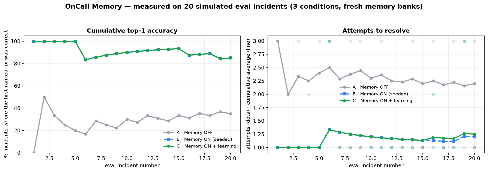

# OnCall Memory

**Incident triage that remembers what actually fixed it.**

OnCall Memory is an on-call copilot for production alerts. It investigates logs,
deploys and metrics, then uses **Hindsight** — Vectorize's agent memory system —
to recall similar past incidents and which fixes worked or failed. Every time an
engineer resolves an incident, the outcome is written back, so the next alert of
the same pattern starts from experience instead of zero.

Everything is simulated: fake services, logs, deploys and metrics. No real
infrastructure is touched, and no fix is ever executed. The "learning" is
persistent memory, **not model retraining**.

Built for the Hindsight hackathon — one persona (on-call engineer), one workflow
(incident triage).

---

## The problem

At 3am, a generic runbook says "restart the service". On a Redis pool exhaustion
or an expired certificate, restarting is the *wrong* move — it buys minutes and
hides the cause. The knowledge that would prevent that mistake already exists in
the team's incident history; it is just not available to the person (or agent)
on call.

## The solution

A triage agent with three properties:

1. **It recalls before it reasons.** The retrieval query is built from the actual
   alert and log excerpt, not just the service name.
2. **It remembers outcomes, not just stories.** "Restart → failed", "renew
   certificate → worked" is stored as memory metadata, so the next answer can
   count successes and failures instead of guessing.
3. **It is honest when it doesn't know.** Two eval incidents match no history.
   The agent says "no relevant history found", gives a clearly-labelled generic
   answer, and never invents incident IDs.

The demo: the same alert with **Memory OFF** ranks `restart_service` first; with
**Memory ON** it cites five past certificate expiries and ranks
`renew_certificate` first with `worked 5/5`.

## Demo

- 60-second script: [DEMO_SCRIPT.md](DEMO_SCRIPT.md)
- Screenshot/GIF placeholders (capture these before submitting):
  - `docs/screenshot-main.png` — the three-zone UI after a memory-ON run
  - `docs/screenshot-compare.png` — memory OFF vs ON side by side
  - `docs/demo.gif` — the 60-second recording

> UI screenshots are intentionally not committed as fabricated images. Run the
> app and capture the real thing; the chart below is generated by the benchmark.

## How Hindsight memory is used

Hindsight is not a side panel here: it is the part that makes the answer better.

### Retain — what gets stored

**One document per incident** (`document_id=incident-INC-014`, so re-seeding
replaces rather than duplicates):

```
Incident INC-014 (checkout-service, 2026-06-02).
Alert: checkout-service p95 latency > 2000ms for 5m.
Symptom: p95 latency 4.1s (SLO 400ms); ConnectionPoolTimeoutError in logs.
Root cause: Redis connection pool exhausted after deploy v2.31.0 cut the pool from 50 to 20 ...
Fixes: restart_service [Restart the service] -> FAILED (latency returned in 6 min);
rollback_deploy_and_increase_pool [...] -> WORKED (rolled back to v2.30.2, pool 60).
Resolved in 25 min by priya.
```

Retained with `context="incident postmortem"` and the incident's real timestamp,
plus metadata: `record_type`, `incident_id`, `service`, `family`,
`outcomes="restart_service:failed;rollback_deploy_and_increase_pool:worked"`.

**One document per fix outcome** (`document_id=outcome-INC-101-<fix>`) when the
engineer clicks Worked / Failed / Partial. Stable IDs make duplicate clicks
idempotent. Outcome documents repeat the alert text so they are retrievable on
their own.

**Bank mission** (set on creation): remember production incidents, their root
causes, and which fixes worked, failed or partially worked, per service.

### Recall — how the query is built

```
Production incident on <service>: <alert>. Symptoms: <symptoms>.
Log evidence: <last ~900 chars of the real log extract>.
Which past incident had the same failure pattern, what was its root cause,
and which fixes worked or failed?
```

`recall` runs Hindsight's multi-strategy retrieval with `max_tokens=1400`. Facts
come back with their metadata; the wrapper **groups facts back into incident-level
memories** (one row per incident in the UI), computes per-fix
`worked/failed/partial` counts from metadata, and filters out results from a
different detected failure pattern. That last gate is what makes an honest "no
relevant history" possible.

Raw `world`/`experience` facts are requested rather than consolidated
observations because observations return without metadata/document IDs and
cannot be attributed to an incident. See [NOTES.md](NOTES.md).

### Reflect — the service panel

"What we know about `checkout-service`" calls Hindsight `reflect`, which runs its
own agentic retrieval over the bank and returns a synthesized summary. It is
advisory context for a human, not part of the ranked-fix decision.

### Feedback loop

```
alert → recall → ranked fixes → engineer clicks Worked/Failed/Partial
      → retain_outcome → next recall includes the outcome
```

The benchmark measures this loop with fresh banks: memory OFF, seeded history,
and seeded history + outcomes learned during the run.

## Learning curve (measured, not drawn)



20 eval incidents, three conditions, fresh Hindsight banks, real Groq calls
(run `20261106-161035-f7f9`, `openai/gpt-oss-120b`):

| Condition | Top-1 correct | Resolved | Avg attempts | Avg simulated time | Heuristic fallbacks |
|---|---|---|---|---|---|
| A · Memory OFF | **35%** (7/20) | 60% | 2.20 | 18.8 min | 10/20 |
| B · Memory ON (seeded) | **85%** (17/20) | 90% | 1.20 | 8.4 min | 11/20 |
| C · Memory ON + learning | **85%** (17/20) | **95%** | 1.25 | 8.4 min | 10/20 |

What the numbers say, including what they do not:

- Recalling history is the difference between generic triage and the right fix:
  top-1 goes from 35% to 85%, and the average number of attempts drops from
  2.20 to 1.20. The simulated engineer's clock follows from attempts, so
  "18.8 min → 8.4 min" is arithmetic on measured attempts, not a separate claim.
- Both genuinely novel alerts (Kafka consumer lag, signing-key rotation) were
  flagged `no_relevant_history` in B and C — the agent did not cite an unrelated
  incident. A got the signing-key case right from logs alone; B/C answered it
  conservatively and ranked `restart_service` first, which failed. Honest
  no-history behaviour is not the same as being right.
- Learning (C) resolves one more incident (95% vs 90%) but does **not** raise
  top-1, because seeded history already covers every recurring family. The one
  visible learning event is `INC-121`, a repeat of the novel Kafka pattern: after
  C recorded `scale_up` working on `INC-119`, recall returned that outcome for
  `INC-121` and the agent's first fix was correct.
- The conflicting-memory cases are the top-1 misses that remain: `INC-106`
  (config drift, `increase_pool_size` works, rollback fails) and `INC-116`
  (deploy-induced, `rollback_deploy_and_increase_pool` works). Memory favours
  whichever variant it saw last; the agent lowers confidence and says so.
- **Confound, stated plainly:** this Groq organisation is on the free tier
  (8,000 tokens/minute). Running 60 investigations back to back hit 429s, and
  10–11 runs per condition fell back to the deterministic analyst after retrying.
  The fallback rate is nearly identical across conditions, every affected row is
  marked in the CSV (`llm_backend`), and the deterministic path uses the same
  recalled memories — but these are not 60 clean LLM runs. A paced run or a paid
  tier should be expected to differ.

The chart is written by `python -m oncall.evaluate`; every point is a real agent
run plus the simulated engineer. `--chart-only` redraws it from the CSV without
spending API calls. Full methodology in
[ARCHITECTURE.md](ARCHITECTURE.md#benchmark-design).

## Quickstart

Requires Python 3.11+ and a Hindsight account/key plus a Groq key for the full
experience. Without keys the app still runs in a clearly-labelled degraded mode.

```bash
# 1. environment
py -3.11 -m venv .venv          # Windows
# python3.11 -m venv .venv      # macOS / Linux
.venv\Scripts\activate          # Windows
# source .venv/bin/activate     # macOS / Linux
pip install -r requirements.txt

# 2. configuration
cp .env.example .env            # then edit .env (Windows: copy .env.example .env)
#   GROQ_API_KEY=...
#   HINDSIGHT_BASE_URL=https://api.hindsight.vectorize.io
#   HINDSIGHT_API_KEY=...
#   HINDSIGHT_BANK_ID=oncall-demo

# 3. verify both services (retain+recall round trip, validated JSON)
python scripts/check_connections.py

# 4. load the 28 resolved history incidents into the bank
python scripts/seed_memory.py

# 5. run the UI
streamlit run app.py
```

Open http://localhost:8501.

### Command line

```bash
python scripts/investigate.py INC-103            # memory ON
python scripts/investigate.py INC-103 --memory off
python scripts/investigate.py INC-103 --compare  # before/after in one output
python scripts/investigate.py INC-103 --json
```

### Benchmark

```bash
python -m oncall.evaluate                # full 20 incidents × 3 conditions (real API calls)
python -m oncall.evaluate --limit 5      # smoke run
python -m oncall.evaluate --chart-only   # redraw from the existing CSV, no API calls
python -m oncall.evaluate --keep-bank    # keep the throwaway banks for inspection
python -m oncall.evaluate --reset --bank oncall-eval-manual
```

Outputs: `reports/benchmark_latest.csv`, `reports/benchmark_latest.json`,
`reports/learning_curve.png`. The demo bank is never used: each condition gets a
fresh `oncall-eval-<run>-<condition>` bank, deleted afterwards unless
`--keep-bank`.

### Tests

```bash
pytest -q
```

Covers schema/controlled-vocabulary validation, data consistency for all 48
incidents, the JSON repair + fallback-model path (mocked Groq), the Hindsight
wrapper (mocked client), grouping/conflict detection, the pattern gate, the
memory guardrail, and the idempotent outcome path.

### Regenerating the simulated world

```bash
python scripts/generate_data.py
pytest tests/test_data.py -q
```

## Project structure

```
app.py                     Streamlit UI (feed · live investigation · memory panel · learning curve)
oncall/
  config.py                .env loading, model + backend settings
  schemas.py               pydantic models + controlled fix vocabulary
  memory.py                Hindsight wrapper (retain/recall/reflect), grouping, local fallback
  llm.py                   Groq JSON calls, validation, repair retry, fallback model
  tools.py                 simulated logs / deploys / metrics + pattern detection
  agent.py                 investigation pipeline, guardrail, agentic mode, outcome recording
  simulator.py             simulated engineer (tries ranked fixes until the true one)
  evaluate.py              3-condition benchmark, CSV/JSON/chart
data/
  services.json            5 services with owners, runtimes, dependencies, SLOs
  incidents_history.json   28 resolved incidents (5 families)
  incidents_eval.json      20 unresolved incidents, hidden true_fix
  deploys.json             48 deploy records consistent with the incidents
  families.json            signature strings + keywords for pattern detection
  logs/                    48 per-incident log extracts
  metrics/                 48 per-incident metric snapshots
scripts/
  generate_data.py         deterministic world generator
  seed_memory.py           idempotent seeding with recall spot-check
  check_connections.py     Hindsight + Groq connectivity verification
  investigate.py           CLI runner (memory ON/OFF/compare, JSON)
tests/
reports/                   benchmark CSV/JSON/chart (generated)
ARCHITECTURE.md  NOTES.md  DEMO_SCRIPT.md
```

## The simulated world

Five services (`checkout-service`, `auth-service`, `search-service`,
`payments-service`, `orders-db`) with owners, runtimes, dependencies and SLOs.
Five recurring incident families, plus two patterns that exist only in the eval
set:

| Family | Signature | What actually works |
|---|---|---|
| Redis pool exhaustion after deploy | `ConnectionPoolTimeoutError` | rollback + raise pool size |
| Memory leak in a release | `OOMKilled`, RSS growth | rollback |
| Expired TLS certificate | `x509: certificate has expired` | renew + reload (restart/rollback fail) |
| Slow query after migration | `canceling statement due to lock timeout` | add the missing index |
| Third-party rate limiting | `429 Too Many Requests` | backoff + circuit breaker |
| Kafka consumer lag *(no seeded history)* | `consumer group lag` | scale consumers |
| Signing-key rotation *(no seeded history)* | `invalid_client` | roll back the rotation |

Data is generated from hand-written templates, then checked by tests: for every
incident the log exists and contains the family signature, the referenced deploy
exists and predates the alert, metric snapshots are ordered, history has exactly
one working fix, and eval records never contain the answer.

## Reliability

The LLM is the unreliable part, so every path has a fallback:

| Failure | Behaviour |
|---|---|
| Hindsight unreachable | visible banner + local keyword fallback (labelled "not Hindsight") |
| Recall fails mid-investigation | continues with memory-OFF behaviour and an error step |
| Groq invalid JSON / schema | one repair retry with the validation error + schema |
| Primary model still failing | retry with `qwen/qwen3-32b` |
| 429s | exponential backoff |
| No key / all attempts fail | deterministic analyst; flagged in UI and CSV |
| Duplicate outcome click | upsert on a stable document ID |
| Empty logs | stated limitation + low confidence |
| Novel incident | `no_relevant_history=true`, no invented IDs |

## Limitations (read this)

- **All data and all systems are simulated.** Logs, metrics, deploys and services
  are generated. Nothing is executed.
- **Advisory only.** The UI states this in the footer; no action is taken.
- **Memory, not training.** Outcomes change what is recalled and how fixes are
  ranked. No model weights are updated.
- **Keyword pattern gate.** Recall precision relies on distinctive error strings
  in `data/families.json`. A real deployment would need a richer classifier, but
  the gate is transparent and testable.
- **Benchmark scope.** 20 incidents is a demo-sized evaluation, not statistical
  proof. The seed and simulated engineer are synthetic. Half the benchmark runs
  fell back to the deterministic analyst because of the free Groq tier's 8k
  tokens/minute limit; the CSV labels each one. Numbers depend on the model and
  on Hindsight Cloud retrieval behavior; the CSV records both.
- **Hindsight facts are grouped heuristically.** Facts are attributed to
  incidents through retain metadata; a fact extracted without that metadata would
  be dropped rather than guessed at.
- **Agentic mode is opt-in.** `AGENT_MODE=deterministic` is the tested default;
  agentic falls back to it on any error.

## Manual steps before submission

1. **Keys.** `GROQ_API_KEY` from console.groq.com; `HINDSIGHT_API_KEY` from
   ui.hindsight.vectorize.io (Create API key). Put both in `.env`; never commit it.
2. **Seed the demo bank** (`python scripts/seed_memory.py`) and run
   `check_connections.py` once on the demo machine.
3. **Capture the screenshots/GIF** listed under Demo. The browser preview in this
   environment was unavailable, so no UI screenshot is committed.
4. **Record the 60-second video** following [DEMO_SCRIPT.md](DEMO_SCRIPT.md).
5. **Optional:** install the Band AI desktop client if the submission requires
   it, and claim any Hindsight Cloud promo credit on the account page.

## Hindsight references

- Docs: https://hindsight.vectorize.io/
- Python client: https://hindsight.vectorize.io/sdks/python
- Retain / recall / reflect: https://hindsight.vectorize.io/developer/api/retain,
  https://hindsight.vectorize.io/developer/api/recall,
  https://hindsight.vectorize.io/developer/api/reflect
- GitHub: https://github.com/vectorize-io/hindsight
