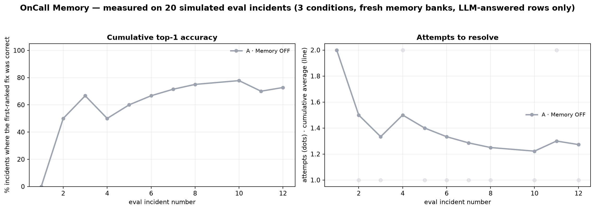

# OnCall Memory

**Incident triage that remembers what actually fixed it.**

OnCall Memory is an on-call copilot for production alerts. It investigates logs,
deploys and metrics, then uses **Hindsight** — Vectorize's agent memory system —
to recall similar past incidents and which fixes worked or failed. Every time an
engineer resolves an incident, the outcome is written back, so the next alert of
the same pattern starts from experience instead of zero.

Everything is simulated: fake services, logs, deploys and metrics. No real
infrastructure is touched, and no fix is ever executed. The "learning" is
persistent memory, **not model retraining**.

Built for the Hindsight hackathon — one persona (on-call engineer), one workflow
(incident triage).

---

## The problem

At 3am, a generic runbook says "restart the service". On a Redis pool exhaustion
or an expired certificate, restarting is the *wrong* move — it buys minutes and
hides the cause. The knowledge that would prevent that mistake already exists in
the team's incident history; it is just not available to the person (or agent)
on call.

## The solution

A triage agent with three properties:

1. **It recalls before it reasons.** The retrieval query is built from the actual
   alert and log excerpt, not just the service name.
2. **It remembers outcomes, not just stories.** "Restart → failed", "renew
   certificate → worked" is stored as memory metadata, so the next answer can
   count successes and failures instead of guessing.
3. **It is honest when it doesn't know.** Two eval incidents match no history.
   The agent says "no relevant history found", gives a clearly-labelled generic
   answer, and never invents incident IDs.

The demo: the same alert with **Memory OFF** ranks `restart_service` first; with
**Memory ON** it cites four past certificate expiries and ranks
`renew_certificate` first with `worked 4/4`.

## Demo

- 60-second script: [DEMO_SCRIPT.md](DEMO_SCRIPT.md)
- Media to capture before submitting (nothing here is committed as a fabricated
  image — run the app and take the real thing):

```
docs/                          ← does not exist yet; create it when you capture
  screenshot-feed.png          ← Live incident tab: feed, trace, result card, memory panel
  screenshot-compare.png       ← compare mode: memory OFF vs ON, same alert, side by side
  screenshot-live-alert.png    ← Live alert tab with a real Alertmanager payload investigated
  screenshot-outcome.png       ← the Worked/Failed/Partial click and the updated counts
  screenshot-curve.png         ← Learning curve tab with the benchmark chart
  demo.gif                     ← the 60-second recording
```

The chart in the next section is different: `reports/learning_curve.png` is
generated by the benchmark, so it is committed and needs no capture.

## How Hindsight memory is used

Hindsight is not a side panel here: it is the part that makes the answer better.

### Retain — what gets stored

**One document per incident** (`document_id=incident-INC-014`, so re-seeding
replaces rather than duplicates):

```
Incident INC-014 (checkout-service, 2026-06-02).
Alert: checkout-service p95 latency > 2000ms for 5m.
Symptom: p95 latency 4.1s (SLO 400ms); ConnectionPoolTimeoutError in logs.
Root cause: Redis connection pool exhausted after deploy v2.31.0 cut the pool from 50 to 20 ...
Fixes: restart_service [Restart the service] -> FAILED (latency returned in 6 min);
rollback_deploy_and_increase_pool [...] -> WORKED (rolled back to v2.30.2, pool 60).
Resolved in 25 min by priya.
```

Retained with `context="incident postmortem"` and the incident's real timestamp,
plus metadata: `record_type`, `incident_id`, `service`, `family`,
`outcomes="restart_service:failed;rollback_deploy_and_increase_pool:worked"`.

**One document per fix outcome** (`document_id=outcome-INC-101-<fix>`) when the
engineer clicks Worked / Failed / Partial. Stable IDs make duplicate clicks
idempotent. Outcome documents repeat the alert text so they are retrievable on
their own.

**Bank mission** (set on creation): remember production incidents, their root
causes, and which fixes worked, failed or partially worked, per service.

### Recall — how the query is built

```
Production incident on <service>: <alert>. Symptoms: <symptoms>.
Log evidence: <last ~900 chars of the real log extract>.
Which past incident had the same failure pattern, what was its root cause,
and which fixes worked or failed?
```

`recall` runs Hindsight's multi-strategy retrieval with `max_tokens=1400`. Facts
come back with their metadata; the wrapper **groups facts back into incident-level
memories** (one row per incident in the UI), computes per-fix
`worked/failed/partial` counts from metadata, and filters out results from a
different detected failure pattern. That last gate is what makes an honest "no
relevant history" possible.

Raw `world`/`experience` facts are requested rather than consolidated
observations because observations return without metadata/document IDs and
cannot be attributed to an incident. See [NOTES.md](NOTES.md).

### Reflect — the service panel

"What we know about `checkout-service`" calls Hindsight `reflect`, which runs its
own agentic retrieval over the bank and returns a synthesized summary. It is
advisory context for a human, not part of the ranked-fix decision.

### Feedback loop

```
alert → recall → ranked fixes → engineer clicks Worked/Failed/Partial
      → retain_outcome → next recall includes the outcome
```

The benchmark measures this loop with fresh banks: memory OFF, seeded history,
and seeded history + outcomes learned during the run.

### Live alerts (real input, not fixtures)

The **Live alert** tab and `webhook.py` feed the *same* memory loop with an
alert somebody actually received.

1. **Ingest.** A pasted Alertmanager/Grafana body, typed text, or a
   `POST /alert` to the local webhook becomes one queued alert with a generated
   id like `LIVE-20261107-134502`. Its `family` comes from the same transparent
   keyword gate (`data/families.json`), or `unclassified` when nothing matches.
   There is no `true_fix` — a live alert has no hidden ground truth.
2. **Recall.** The query is built from the real alert text plus the log lines
   the engineer pasted, exactly like the fixture path. The pattern gate still
   drops memories from a different failure family, so a novel real alert can
   honestly return "no relevant history".
3. **Reason.** Groq gets the supplied evidence only. If no deploys or metrics
   came with the alert, the answer says so in its evidence list instead of
   inventing a deploy or a latency number.
4. **Retain.** Clicking Worked / Failed / Partial writes
   `document_id=outcome-LIVE-…-<fix>` with the same metadata shape as any other
   outcome. The next alert of that pattern — simulated or real — recalls it, and
   the live incident itself becomes citable history (`INC-…` and `LIVE-…` ids
   are both allowed, and only ids present in recalled memories survive the
   post-processing gate).

So the bank holds two kinds of experience, both labelled: seeded postmortems
(`incident-INC-014`) and outcomes from real use (`outcome-LIVE-…`). Nothing is
executed for either.

## Learning curve (measured, not drawn)



This is the earlier real run, `20261106-161035-f7f9`, with Hindsight Cloud and
`openai/gpt-oss-120b`. The table below is read from the saved CSV and JSON in
`reports/earlier_run/` and is not a clean A/B/C proof.

| Condition | Top-1 | Resolved | Avg attempts | Avg simulated min | Fallback runs |
|---|---:|---:|---:|---:|---:|
| A · memory OFF | 35% | 60% | 2.20 | 18.8 | 10/20 |
| B · seeded | 85% | 90% | 1.20 | 8.4 | 11/20 |
| C · seeded + learning | 85% | 95% | 1.25 | 8.4 | 10/20 |

**This is run 20261106-161035-f7f9; about half of the rows in each condition were answered by the deterministic fallback after Groq free-tier 429s (counted from the `llm_backend` column in the CSV).** The memory-OFF fallback ranks `restart_service` first by construction, so part of the A-vs-B gap is built in; the signal is that recall changes fix ranking, not an LLM-vs-LLM proof.

The latest benchmark on 2026-11-07 is intentionally kept separate because it could not complete. Hindsight DNS failures caused the seeded and learning banks to fall back to local keyword memory, and the Groq organization hit its 200,000-token daily cap at 198,589 used before all conditions finished. That run remains visible in the app under the "Latest run (incomplete)" expander and in `reports/benchmark_latest.json`, but it is not used as the headline benchmark. The benchmark now supports `--tpm` and `--pace`, truncates logs to about 3,000 characters, and records `llm_failed` rows instead of substituting the heuristic when `--no-fallback` is set. Fallback rows stay visible but are excluded from headline metrics; this is especially important in condition A, where the memory-OFF heuristic hardcodes `restart_service` first. A clean A/B/C comparison needs another complete run after the daily quota resets and Hindsight Cloud connectivity is restored.

## Quickstart

Requires Python 3.11+ and a Hindsight account/key plus a Groq key for the full
experience. Without keys the app still runs in a clearly-labelled degraded mode.

```bash
# 1. environment
py -3.11 -m venv .venv          # Windows
# python3.11 -m venv .venv      # macOS / Linux
.venv\Scripts\activate          # Windows
# source .venv/bin/activate     # macOS / Linux
pip install -r requirements.txt

# 2. configuration
cp .env.example .env            # then edit .env (Windows: copy .env.example .env)
#   GROQ_API_KEY=...
#   HINDSIGHT_BASE_URL=https://api.hindsight.vectorize.io
#   HINDSIGHT_API_KEY=...
#   HINDSIGHT_BANK_ID=oncall-demo

# 3. verify both services (retain+recall round trip, validated JSON)
python scripts/check_connections.py

# 4. load the 28 resolved history incidents into the bank
python scripts/seed_memory.py

# 5. run the UI
streamlit run app.py
```

Open http://localhost:8501.

### Command line

```bash
python scripts/investigate.py INC-103            # memory ON
python scripts/investigate.py INC-103 --memory off
python scripts/investigate.py INC-103 --compare  # before/after in one output
python scripts/investigate.py INC-103 --json
python scripts/validate_data.py                  # PASS/FAIL data-consistency checks
```

### Real alerts instead of fixtures

```bash
python webhook.py                    # local receiver on http://127.0.0.1:8081
python scripts/send_alert.py         # POST an Alertmanager-shaped sample
python scripts/send_alert.py --kind grafana
python scripts/send_alert.py --service orders-db --alert "disk pressure" --log-file ./tail.log
```

Point a real Alertmanager or Grafana contact point at `POST /alert` instead of
using the samples. Queued alerts appear at the top of the incident feed and in
the **Live alert** tab, which investigates them with the same recall + reasoning
+ outcome loop. The receiver binds to `127.0.0.1` and has no auth — it only
appends to `.live_alerts/queue.jsonl`; put TLS and authentication in front of it
before exposing it anywhere.

### Benchmark

```bash
python -m oncall.evaluate                        # full 20 incidents × 3 conditions (real API calls)
python -m oncall.evaluate --no-fallback          # count only rows the LLM actually answered
python -m oncall.evaluate --tpm 6500 --pace 3    # pace under the Groq free-tier token limit
python -m oncall.evaluate --limit 5              # smoke run
python -m oncall.evaluate --chart-only           # redraw from the existing CSV, no API calls
python -m oncall.evaluate --keep-bank            # keep the throwaway banks for inspection
python -m oncall.evaluate --reset --bank oncall-eval-manual
```

Outputs: `reports/benchmark_latest.csv`, `reports/benchmark_latest.json`,
`reports/learning_curve.png`. The demo bank is never used: each condition gets a
fresh `oncall-eval-<run>-<condition>` bank, deleted afterwards unless
`--keep-bank`.

### Data consistency

```bash
python scripts/validate_data.py
```

The standalone consistency validator prints one PASS/FAIL line per invariant
over all 48 incidents and exits non-zero on a failure: schema and
controlled-vocabulary validation, log existence and family signatures,
referenced deploy existence and timing, time-ordered metric snapshots, history
resolution integrity, public eval records without `true_fix`, no fix-vocabulary
leakage into agent-visible text, and reproducible pattern detection.

### Regenerating the simulated world

```bash
python scripts/generate_data.py
python scripts/validate_data.py
```

## Project structure

```
app.py                     Streamlit UI (feed · investigation · memory · live alerts · curve)
webhook.py                 FastAPI receiver: POST /alert → the live alert queue
oncall/
  config.py                .env loading, model + backend settings
  schemas.py               pydantic models + controlled fix vocabulary
  memory.py                Hindsight wrapper (retain/recall/reflect), grouping, local fallback
  llm.py                   Groq JSON calls, validation, repair retry, fallback model
  tools.py                 simulated logs / deploys / metrics + pattern detection
  live.py                  real input: webhook parsing, live incidents, alert queue
  agent.py                 investigation pipeline, guardrail, agentic mode, outcome recording
  simulator.py             simulated engineer (tries ranked fixes until the true one)
  evaluate.py              3-condition benchmark, pacing, CSV/JSON/chart
data/
  services.json            5 services with owners, runtimes, dependencies, SLOs
  incidents_history.json   28 resolved incidents (5 families)
  incidents_eval.json      20 unresolved incidents, hidden true_fix
  deploys.json             48 deploy records consistent with the incidents
  families.json            signature strings + keywords for pattern detection
  logs/                    48 per-incident log extracts
  metrics/                 48 per-incident metric snapshots
scripts/
  generate_data.py         deterministic world generator
  validate_data.py         PASS/FAIL data-consistency checks (not a test suite)
  seed_memory.py           idempotent seeding with recall spot-check
  check_connections.py     Hindsight + Groq connectivity verification
  investigate.py           CLI runner (memory ON/OFF/compare, JSON)
  send_alert.py            POST a sample Alertmanager/Grafana alert to the webhook
.live_alerts/              runtime queue file (gitignored, created by the webhook)
reports/                   benchmark CSV/JSON/chart (generated)
ARCHITECTURE.md  NOTES.md  DEMO_SCRIPT.md
```

## The simulated world

Five services (`checkout-service`, `auth-service`, `search-service`,
`payments-service`, `orders-db`) with owners, runtimes, dependencies and SLOs.
Five recurring incident families, plus two patterns that exist only in the eval
set:

| Family | Signature | What actually works |
|---|---|---|
| Redis pool exhaustion after deploy | `ConnectionPoolTimeoutError` | rollback + raise pool size |
| Memory leak in a release | `OOMKilled`, RSS growth | rollback |
| Expired TLS certificate | `x509: certificate has expired` | renew + reload (restart/rollback fail) |
| Slow query after migration | `canceling statement due to lock timeout` | add the missing index |
| Third-party rate limiting | `429 Too Many Requests` | backoff + circuit breaker |
| Kafka consumer lag *(no seeded history)* | `consumer group lag` | scale consumers |
| Signing-key rotation *(no seeded history)* | `invalid_client` | roll back the rotation |

Data is generated from hand-written templates, then checked by
`python scripts/validate_data.py`: for every incident the log exists and contains the family signature, the referenced deploy
exists and predates the alert, metric snapshots are ordered, history has exactly
one working fix, and eval records never contain the answer.

## Reliability

The LLM is the unreliable part, so every path has a fallback:

| Failure | Behaviour |
|---|---|
| Hindsight unreachable | visible banner + local keyword fallback (labelled "not Hindsight") |
| Recall fails mid-investigation | continues with memory-OFF behaviour and an error step |
| Groq invalid JSON / schema | one repair retry with the validation error + schema |
| Primary model still failing | retry with `openai/gpt-oss-20b` |
| 429s | exponential backoff |
| No key / all attempts fail | deterministic analyst; flagged in UI and CSV |
| Duplicate outcome click | upsert on a stable document ID |
| Empty logs | stated limitation + low confidence |
| Novel incident | `no_relevant_history=true`, no invented IDs |

## Limitations (read this)

- **All data and all systems are simulated.** Logs, metrics, deploys and services
  are generated. Nothing is executed.
- **Advisory only.** The UI states this in the footer; no action is taken.
- **Memory, not training.** Outcomes change what is recalled and how fixes are
  ranked. No model weights are updated.
- **Keyword pattern gate.** Recall precision relies on distinctive error strings
  in `data/families.json`. A real deployment would need a richer classifier, but
  the gate is transparent and its 48/48 result on the generated data is checked
  by `scripts/validate_data.py`.
- **Benchmark scope.** 20 incidents is a demo-sized evaluation, not statistical
  proof. The seed and simulated engineer are synthetic. Half the benchmark runs
  fell back to the deterministic analyst because of the free Groq tier's 8k
  tokens/minute limit; the CSV labels each one. Numbers depend on the model and
  on Hindsight Cloud retrieval behavior; the CSV records both.
- **Hindsight facts are grouped heuristically.** Facts are attributed to
  incidents through retain metadata; a fact extracted without that metadata would
  be dropped rather than guessed at.
- **Agentic mode is opt-in.** `AGENT_MODE=deterministic` is the default, and the
  only mode exercised end-to-end; agentic falls back to it on any error.

## Manual steps before submission

1. **Keys.** `GROQ_API_KEY` from console.groq.com; `HINDSIGHT_API_KEY` from
   ui.hindsight.vectorize.io (Create API key). Put both in `.env`; never commit it.
   The demo `.env` sets `MEMORY_BACKEND=hindsight` so a Hindsight failure shows up
   as a loud banner instead of a silent keyword-fallback demo.
2. **Verify and seed on the demo machine.** `python scripts/check_connections.py`
   (green retain+recall round trip and validated JSON), then
   `python scripts/seed_memory.py`.
3. **Reset the bank after any demo run.** Outcome clicks stay in the bank; before
   recording, run `python scripts/seed_memory.py --reset --force` so
   the counts shown on camera are the seeded ones.
4. **Warm up on camera-adjacent time.** Open the app: the green
   "Warm-up passed" line means Hindsight and Groq are both live. Then press
   **Demo prep → Pre-run the scripted demo incidents** so the trace and the
   OFF-vs-ON comparison replay from cache instead of waiting on the API.
5. **Capture the media listed under Demo** into `docs/`. None of it is committed
   yet — the files in that list still have to be made from the running app.
6. **Record the 60-second video** following [DEMO_SCRIPT.md](DEMO_SCRIPT.md).

## Band AI desktop

Band AI desktop was not used in this project.

## Submission checklist

Judge-facing items, each with where it lives:

- [ ] **GitHub repo** — public, this README first thing; `git status` clean, no
      `.env` committed (only `.env.example`, keys left blank).
- [ ] **Demo video** — 60 seconds, follows [DEMO_SCRIPT.md](DEMO_SCRIPT.md);
      record after the bank reset and the pre-run step above.
- [ ] **Live demo** — `streamlit run app.py` on a machine with both keys in
      `.env`; the warm-up line green before you share the link.
- [ ] **How Hindsight is used** — the
      [How Hindsight memory is used](#how-hindsight-memory-is-used) section:
      retain (postmortem + outcome documents), recall (query construction,
      pattern gate), reflect (service panel), the feedback loop, and the
      live-alert flow that puts real experience into the same bank.
- [ ] **Per team member — article** — one written piece each, following the
      official content guide; link it here when published.
- [ ] **Per team member — social post** — one post each per the guide, with the
      repo and demo links.
- [ ] **Per team member — video** — one short video each per the guide.
- [ ] **Hindsight Cloud promo credit** — claim it on the account page if the
      submission requires it.
- [ ] **Benchmark honesty** — re-read the confound note under the learning curve;
      the table reports LLM-answered rows only, and the CSV keeps every excluded
      row.

## Hindsight references

- Docs: https://hindsight.vectorize.io/
- Python client: https://hindsight.vectorize.io/sdks/python
- Retain / recall / reflect: https://hindsight.vectorize.io/developer/api/retain,
  https://hindsight.vectorize.io/developer/api/recall,
  https://hindsight.vectorize.io/developer/api/reflect
- GitHub: https://github.com/vectorize-io/hindsight
